<picture><source media="(prefers-color-scheme: dark)" srcset="assets/hero-dark.svg"></picture>

<picture><source media="(prefers-color-scheme: dark)" srcset="assets/stack-dark.svg"></picture>

<a href="https://github.com/nornsPOS"><picture><source media="(prefers-color-scheme: dark)" srcset="assets/norns-dark.svg"></picture></a>
<a href="https://github.com/h4ckf0r0day/obscura/pulls?q=is%3Apr+author%3A963s"><picture><source media="(prefers-color-scheme: dark)" srcset="assets/obscura-dark.svg"></picture></a>

<a href="https://github.com/pulls?q=is%3Apr+author%3A963s+-user%3A963s"><picture><source media="(prefers-color-scheme: dark)" srcset="assets/receipts-dark.svg"></picture></a>
