<picture><source media="(prefers-color-scheme: dark)" srcset="assets/hero-dark.svg"></picture>

<a href="https://github.com/nornsPOS"><picture><source media="(prefers-color-scheme: dark)" srcset="assets/norns-dark.svg"></picture></a>
<a href="https://github.com/h4ckf0r0day/obscura/pulls?q=is%3Apr+author%3A963s"><picture><source media="(prefers-color-scheme: dark)" srcset="assets/obscura-dark.svg"></picture></a>

<picture><source media="(prefers-color-scheme: dark)" srcset="assets/stack-dark.svg"></picture>

<b>the receipts</b>

 

**obscura**, the rust headless browser for ai agents

| | |
|---|---|
| [#806](https://github.com/h4ckf0r0day/obscura/pull/806) | fixed and absolute boxes resolve against the viewport |
| [#805](https://github.com/h4ckf0r0day/obscura/pull/805) | navigation follows 20 redirects, not 19 |
| [#804](https://github.com/h4ckf0r0day/obscura/pull/804) | chrome-shaped blob urls, throw on non-blob input |
| [#803](https://github.com/h4ckf0r0day/obscura/pull/803) | `new FormData(form)` reads the form |
| [#120](https://github.com/h4ckf0r0day/obscura/pull/120) | puppeteer connect no longer times out |
| [#816](https://github.com/h4ckf0r0day/obscura/pull/816) | **found:** ssrf through ipv6 addresses carrying an ipv4 inside (6to4, nat64), reaching cloud metadata endpoints. closed in favour of the upstream fix |

**norns-xrf-agent** · [#1](https://github.com/nornsPOS/norns-xrf-agent/pull/1) reliable delivery of xrf analyser results, windows startup

